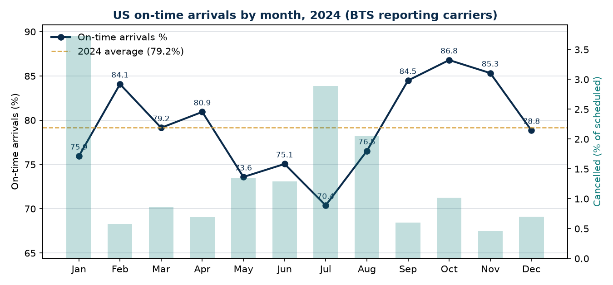
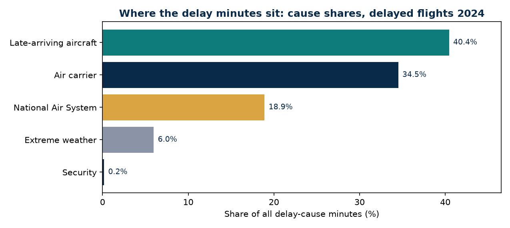
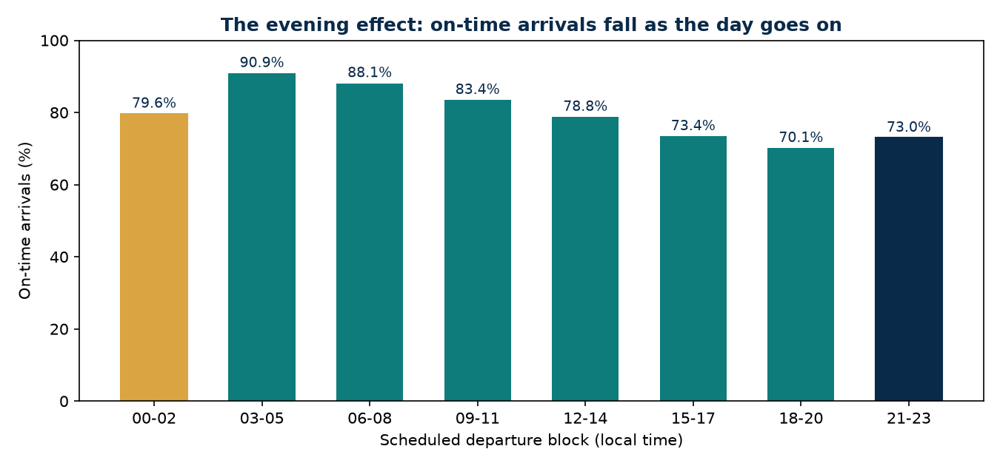

<div align="center">

# ✈️ How Late Is US Air Travel, Really?

**A full year of BTS on-time data — 7,079,061 flights in 2024 — checked the slow way: every file hashed, every row counted twice, every delay cause reconciled to the minute.**

[](#data--provenance)
[-0E7C7B)](#the-questions)
[](#1--how-late-is-us-air-travel-really)
[](LICENSE)

*One in five arrivals landed 15+ minutes late in 2024. When they were late, they averaged 71.6 minutes late. And the single biggest reason, by minutes, was the flight before.*

</div>

---

## Why this exists

Airline reliability is usually argued from anecdotes and a single
headline percentage. The underlying data is public: every U.S.
reporting carrier files every scheduled domestic flight with the
Bureau of Transportation Statistics — departure and arrival times,
cancellations, diversions, and, for late flights, a minute-by-minute
split of *why*. This project takes the complete 2024 year of that
table and answers five plain questions from it, with the verification
done in the open: file hashes pinned, row counts produced by two
independent code paths, and the delay-cause arithmetic reconciled
exactly before a single finding was written down.

> **Every number below comes from the executed pipeline.** Metrics are
> saved to `outputs/metrics.json` by the analysis script itself; the
> README quotes that file. If a number isn't in the run, it isn't in
> the README.

## The questions

1. How late is US air travel, really — nationally, and by month?
2. Which reporting carriers are most and least reliable?
3. What actually causes the delays?
4. How much worse does it get as the day goes on (the evening effect)?
5. What does this mean at two airports I actually use — ILM (Wilmington, NC) and DTW (Detroit)?

| Design choice | What was done, and why |
|---|---|
| Unit | One row = one scheduled non-stop domestic flight, as filed by its **operating (reporting)** carrier in the BTS Reporting Carrier On-Time Performance table |
| Scope | All 12 monthly files, calendar year 2024: **7,079,061 flights** |
| On-time | Arrived less than 15 minutes after the published arrival time (the DOT definition; `ArrDel15 == 0`) |
| Cancelled flights | Counted in schedule totals and cancellation rates. They have **no delay values** — none are imputed, ever |
| Diverted flights | Counted as operated, excluded from arrival-delay statistics: BTS sets their arrival-delay fields to NULL by design |
| Delayed flights | Operated, non-diverted, `ArrDel15 == 1`. Means/medians of delay use these rows only; `ArrDelayMinutes` counts early arrivals as 0 |
| Delay causes | The five BTS cause fields exist **only for flights that arrived 15+ minutes late** and only where cause reporting applies. Shares are over total cause minutes |
| Carrier ranking | All 15 carriers in the 2024 data operated ≥ 10,000 flights and are ranked; the stated threshold for ranking is 10,000 scheduled flights |
| Departure blocks | Scheduled departure hour (local) in 3-hour blocks; hourly detail is in `outputs/metrics.json` |

## Key findings

### 1 · How late is US air travel, really

Of **7,079,061** scheduled flights in 2024, **79.2%** of arrivals were
on time and **1.36%** of flights were cancelled (96,315). The
**1,449,966** flights that arrived 15+ minutes late — 20.8% of
arrivals — averaged **71.6 minutes** late; the median late flight was
**41.0 minutes** late, so the mean is pulled up by a long tail of
very late arrivals.

Seasonality is strong and not quite the folk version:



- **October was the best month of the year: 86.8% on time**, and its
  delayed flights were also the least late (61.0 minutes on average).
- **July was the worst: 70.4% on time**, 29.6% of arrivals 15+ late,
  delayed flights averaging 80.6 minutes, and 2.89% of flights
  cancelled (18,372) — the peak summer schedule meeting summer storms
  in the month of the 19 July global IT outage.
- **January cancelled the most flights of any month: 20,389 (3.73%)**,
  a winter-weather signature, yet its on-time rate (75.9%) still beat
  May, June and July. November cancelled the fewest (0.46%).

### 2 · Which carriers are most and least reliable

By **operating** carrier — note that Republic, Endeavor, SkyWest,
Envoy and PSA fly under the major brands' names, so a "Delta" ticket
may be an Endeavor flight:

| Carrier | On-time arrivals % | Cancelled % | Delayed flights' mean delay (min) |
|---|---|---|---|
| Republic Airways (YX) | **85.9** | 1.85 | 67.5 |
| Hawaiian Airlines (HA) | 84.6 | 1.05 | 46.2 |
| Endeavor Air (9E) | 84.2 | 2.30 | 79.9 |
| Delta Air Lines (DL) | 82.7 | 0.91 | 72.0 |
| SkyWest Airlines (OO) | 81.0 | 1.15 | 80.4 |
| United Airlines (UA) | 80.1 | 1.64 | 72.7 |
| Southwest Airlines (WN) | 79.4 | **0.83** | 54.0 |
| Envoy Air (MQ) | 79.1 | 1.42 | 64.6 |
| Allegiant Air (G4) | 78.3 | 1.72 | **88.7** |
| PSA Airlines (OH) | 78.2 | 1.65 | 83.6 |
| Alaska Airlines (AS) | 77.9 | 1.96 | 50.5 |
| Spirit Airlines (NK) | 76.1 | 1.91 | 70.2 |
| JetBlue Airways (B6) | 74.5 | 1.55 | 78.7 |
| American Airlines (AA) | 73.9 | 1.55 | 85.7 |
| Frontier Airlines (F9) | **71.3** | **2.32** | 79.4 |

Three patterns hide inside the single ranking. **Southwest cancels
least** (0.83%) and flew the most flights of anyone (1,419,419).
**Delta is the strongest of the big brands** on both on-time arrivals
(82.7%) and cancellations (0.91%). And *how late when late* is its own
axis: Alaska's and Southwest's delayed flights average only ~50–54
minutes, while Allegiant's average 88.7 and American's 85.7 — some
carriers are late often but briefly; others are late rarely and long,
or, in American's and Frontier's cases, both.

### 3 · What actually causes the delays

For the 1,449,966 delayed flights, BTS splits every late minute into
five causes (103,794,712 minutes in total):



| Cause | Share of all delay minutes |
|---|---|
| Late-arriving aircraft (the inbound flight was late) | **40.4%** |
| Air carrier (within the airline's control) | 34.5% |
| National Air System (ATC, volume, non-extreme weather) | 18.9% |
| Extreme weather | 6.0% |
| Security | 0.2% |

The headline: **the largest single cause of lateness is earlier
lateness** — 40.4% of all delay minutes are knock-on effects of the
aircraft arriving late from its previous flight. Weather, the cause
passengers most often hear announced, is 6.0% of delay *minutes*.
(That is not weather's whole footprint: weather drives a large share
of *cancellations*, which carry no delay minutes and so cannot appear
in this table.) More than half of delayed flights carry some
carrier-attributed minutes (54.4%) and some late-aircraft minutes
(51.3%) — most real delays are blends, and the minute split is where
the blend shows.

### 4 · The evening effect



Reliability is a function of the clock. Flights scheduled to depart
in the **03–05 block arrive on time 90.9%** of the time (the first
flights of the day: aircraft and crews start in position, the system
starts empty). From there, on-time arrivals fall with **every
successive block** — 88.1% (06–08), 83.4% (09–11), 78.8% (12–14),
73.4% (15–17) — to **70.1% in the 18–20 block**, where 29.9% of
arrivals are 15+ minutes late. The 21–23 block recovers slightly
(73.0%) as the schedule thins; the small 00–02 block (17,951 red-eyes)
sits at 79.6%. Delays compound through the day for the same reason
Finding 3 gives: each late arrival becomes the next flight's
late-arriving aircraft.

### 5 · Two airports I actually use

| | ILM — Wilmington, NC | DTW — Detroit, MI |
|---|---|---|
| Departures scheduled | 8,069 | 131,367 |
| Departures cancelled | 1.75% | 1.03% |
| On-time departures | 83.0% | 81.6% |
| On-time arrivals | 79.7% | 82.0% |
| Delayed arrivals' mean delay | 65.9 min (median 44.0) | 80.0 min (median 45.0) |
| Total flights involving the airport | 16,141 | 262,727 |

**ILM** is a small airport (about 8,000 departures a year) that tracks
the national picture on arrivals (79.7% vs 79.2%) but **cancels
departures at 1.75%, above the national 1.36%** — at a small station,
one cancelled departure is a bigger share of the day, and its
percentages carry wider uncertainty than DTW's. **DTW**, a Delta hub,
beats the nation comfortably on cancellations (1.03%) and on-time
arrivals (82.0%) — but when a DTW arrival *is* late, it is later than
the national pattern (80.0 vs 71.6 minutes on average).

## Integrity checks (run, not asserted)

- **Bytes pinned:** all 12 monthly zips were recorded with URL, size,
  HTTP Last-Modified and SHA-256 in `data/raw/download_manifest.json`
  at download time (354,314,874 bytes in total; December's file
  carries a server timestamp of 14 Mar 2025, the day BTS published
  the full-year 2024 Air Travel Consumer Report).
- **Rows counted twice, two ways:** `src/00_verify_data.py` streams
  each CSV with the stdlib csv module; the analysis loads with
  pandas. The per-month counts agree exactly, all 12 months, for a
  total of **7,079,061** rows. A raw newline count for January
  (547,272 = header + 547,271 records) confirms one line is one
  record in this table.
- **BTS's own documentation, bundled and identical:** every zip
  contains BTS's record layout as `readme.html`; it is byte-identical
  across all 12 files (SHA-256
  `0ba795b87d903d1b556ea93c19924cab0d240deb478e53a2f551b37ea6686867`).
- **Missing data is structural, never filled:** cancelled flights
  with a non-null arrival delay: **0**. Operated flights with a null
  arrival delay: **17,499 — exactly the diverted flights**, whose
  arrival-delay fields BTS documents as NULL by design.
- **Delay-cause arithmetic reconciles exactly:** for the 1,449,964
  delayed flights that carry cause fields, the five causes sum to the
  flight's `ArrDelayMinutes` in **100.0%** of cases. (Two delayed
  flights of 1,449,966 carry no cause fields at all; they are in the
  delayed counts and out of the cause shares, and they are the reason
  the two totals differ.)
- **One flight is scheduled at "2400":** a single record carries
  `CRSDepTime` 2400 (midnight written as 24:00). It is counted in
  every total in this project except the 3-hour departure blocks,
  which is why the blocks sum to 7,079,060.
- **Determinism:** the full analysis was run twice;
  `outputs/metrics.json` is byte-identical across runs (SHA-256
  `961151e266736fc38ea104fd6f69fcd8fd1a62d6dc2a60557f73a34f95c098d7`).

## A note on BTS's own headline numbers

DOT's Air Travel Consumer Report for full-year 2024 reports a
**78.10%** on-time arrival rate and **1.4%** cancellations. This
project's figures are **79.18%** and **1.36%**. The gap is a scope
difference between two BTS products, flagged rather than smoothed
over: the ATCR aggregates the 10 **marketing** carrier networks
(brand-level), whose data additionally counts branded code-share
flying operated by small partner carriers that do not report into
this table — December 2024 alone shows 631,944 marketing-scheduled
flights vs 590,581 in this table (−6.5%), with the same ~6% count gap
in other months, while the December *rates* agree closely (on-time
78.0% vs 78.85% here; cancellations 0.7% vs 0.70%). This project
analyses the **operating-carrier** table throughout, and says so
wherever the numbers could be confused with the ATCR's.

## Limitations — read before citing

1. **Operating carrier ≠ the brand on the ticket.** Regional
   operators (YX, 9E, OO, MQ, OH…) appear under their own names.
   Brand-level ("marketing carrier") figures — the ones DOT headlines
   — differ; see the note above.
2. **Causes exist only for late arrivals.** A flight cancelled for
   weather contributes no weather minutes. The 6.0% weather share is
   a share of *delay minutes on operated late flights*, not of all
   disruption.
3. **"On time" is a 15-minute gate.** A flight 14 minutes late is on
   time; a flight 3 hours late and one 16 minutes late are both just
   "delayed." The mean/median delay of delayed flights is the
   corrective, and both are reported.
4. **Schedule padding is invisible here.** Airlines can and do pad
   published schedules; an improving on-time rate can partly be a
   longer published block time. This dataset records performance
   against the published schedule, not against physics.
5. **This table is non-stop domestic flights by reporting carriers.**
   International flying, and small carriers that do not report, are
   outside it by construction.
6. **One year, one country.** 2024 includes the 19 July IT outage;
   treat single-month extremes (July, January) as weather-and-events
   stories, not baselines.

## Reproduce

```bash
python -m venv .venv && source .venv/bin/activate
pip install -r requirements.txt
python src/01_download_data.py   # 12 monthly PREZIP files from transtats.bts.gov + hash manifest
python src/00_verify_data.py     # independent row counts, readme + published-figure checks
python src/02_ontime_analysis.py # all findings -> outputs/metrics.json + charts
```

Raw data lands in `data/raw/` and is never committed
(see `data/README_DATA.md`).

## Data & provenance

**Source:** U.S. Department of Transportation, Bureau of
Transportation Statistics, *Reporting Carrier On-Time Performance
(1987-present)*, TranStats (database OST_R). Monthly pre-zipped CSVs
for calendar year 2024, downloaded 2026-10-27 from
https://transtats.bts.gov/PREZIP/.

**Filename note:** older guides cite the files as
`On_Time_Reporting_Carrier_On_Time_Performance_(1987-present)_YYYY_M.zip`.
That parenthesised name now returns HTTP 404; the live PREZIP
listing uses underscores —
`On_Time_Reporting_Carrier_On_Time_Performance_1987_present_YYYY_M.zip`.
Same table, same publisher; only the naming changed. The download
script documents this and pins the live names.

**Licence:** U.S. Government data — **public domain**
(17 U.S.C. § 105). BTS asks that it be credited as the source.

## Repository layout

```
airline-ontime-bts/
├── src/
│   ├── 00_verify_data.py      # independent counts vs manifest + published figures
│   ├── 01_download_data.py    # PREZIP downloads + SHA-256 manifest
│   └── 02_ontime_analysis.py  # the five questions -> metrics.json + charts
├── data/
│   ├── README_DATA.md         # provenance, licences, definitions
│   └── raw/                   # monthly zips + manifest (git-ignored, ~354 MB)
└── outputs/
    ├── metrics.json           # every number in this README
    ├── data_verification.json # counts, hashes, published-figure comparison
    ├── results_summary.md     # the same results, as a one-page brief
    ├── run_log.txt            # build log: commands, outputs, determinism check
    └── charts/                # monthly trend, cause shares, evening effect
```

## License

Code: MIT — see [LICENSE](LICENSE). Data: public domain,
© U.S. Department of Transportation / BTS (see above).
